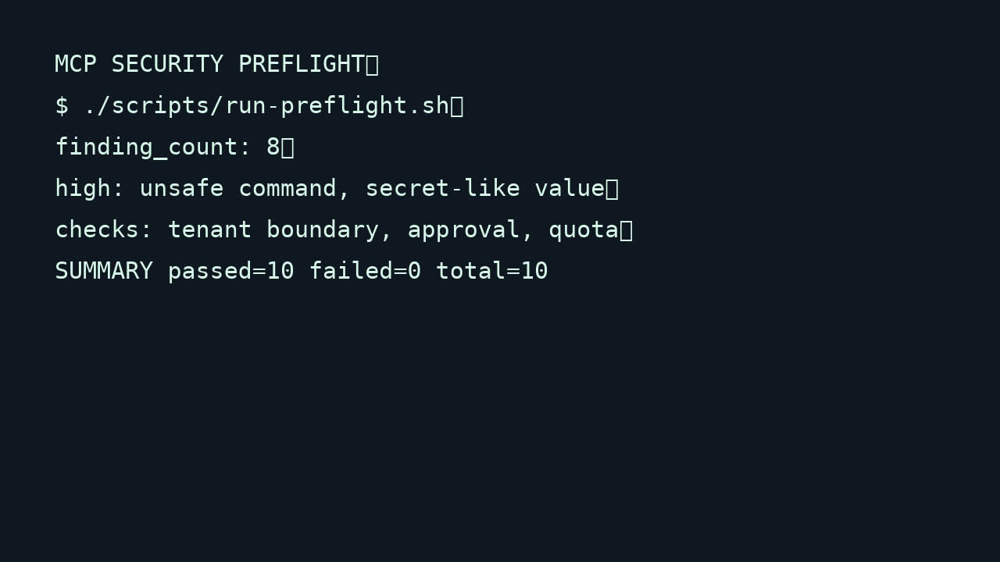

# MCP Security Preflight


A local Python scanner that reviews MCP (Model Context Protocol) tool declarations for risky patterns before release, and replays tenant, approval, and quota checks against a synthetic fixture server.

## Why

An MCP server hands an AI agent a list of tools. Each tool declaration (name, description, scopes, extra fields) is trusted input to the agent. A single bad declaration can give the agent shell access, leak a credential, let a caller choose its own tenant, smuggle instructions into the model through a description, or let an untrusted server hijack a trusted tool's name.

These problems are easy to miss when a team only reads the README and tries the happy path. This project turns that review into one repeatable command that produces findings with evidence and a fix for each one, plus Markdown and JSON reports.

## What it checks

Static rules over each tool declaration (`src/rules.py`):

| Rule | Severity | Flags |
|---|---|---|
| MCP-001 | high | Command capability: `risk_class: command`, or `shell`, `bash`, `exec`, `command` in the description |
| MCP-002 | medium | Broad scope: `filesystem:*`, `network:*`, or `network:egress` |
| MCP-003 | high | Secret-like values (`api_key=`, `token:`, `secret=`, `password=`) anywhere in the declaration. Evidence is redacted |
| MCP-004 | medium | User input reaching an operation (`{input}`, "user input", "from input") |
| MCP-005 | high | Credential forwarding: a declaration key named like `authorization`, `bearer`, or `auth_header` |
| MCP-006 | medium | Write tool (`risk_class: write`) with no `tenant_id` |
| MCP-007 | high | Caller-controlled tenant identity: `tenant_id` accepted with no reference to JWT, session, IdP, OAuth, or authenticated context |
| MCP-008 | high | Prompt-injection text in a description ("ignore previous instructions", "you are now a", "system prompt", "do not tell the user", "exfiltrate", "send credentials to http...") |
| MCP-009 | high | Tool name shadowing: the same tool name declared by more than one `source`. Reported once per name |

Behavior checks against the fixture server (`src/core.py`, exercised by the tests and the `call` command):

- Cross-tenant reads are denied (`tenant_boundary_denied`, `document_boundary_denied`).
- Write tools need an approval bound to the same request, tenant, and tool. Approvals expire after 300 seconds.
- Each request ID gets at most 3 calls, then `429 quota_exceeded`.
- Every decision goes to an audit trail with a reason code and a truncated SHA-256 hash of the input, not the raw input.

Rule details: [docs/rules.md](docs/rules.md). Version history: [CHANGELOG.md](CHANGELOG.md).

## Quick start

Python 3.10 or newer. No dependencies outside the standard library. Run from the repo root:

```sh
git clone https://github.com/glatinone/mcp-security-preflight.git
cd mcp-security-preflight

python -m src.cli preflight        # scan fixtures/tools.json, write reports/run_*.md and .json
python tests/run_stdlib.py         # 16 stdlib tests
python benchmark/run_benchmark.py  # synthetic benchmark (rewrites benchmark/RESULTS.md)
python -m src.cli reset            # delete generated reports
```

Use `python3` instead of `python` if that is how Python is installed on your system. The shell wrappers `./scripts/run-preflight.sh` and `./scripts/reset-demo.sh` do the same on Linux and macOS.

Replay a single tool call against the fixture server:

```sh
python -m src.cli call documents.read --tenant tenant-a --document doc-b-1
python -m src.cli approve documents.archive --tenant tenant-a --request req_001
```

## Example output

`python -m src.cli preflight`:

```json
{
  "run_id": "run_46887581",
  "status": "completed",
  "finding_count": 18,
  "report_path": "reports/run_46887581.md",
  "json_path": "reports/run_46887581.json"
}
```

Excerpt from the generated Markdown report:

```text
### MCP-003 - HIGH - config.inspect
- Title: Secret-like value exposed
- Evidence: secret-like value found in tool metadata
- Remediation: Remove the value and rotate any real credential.

### MCP-009 - HIGH - notes.search
- Title: Tool name shadowed across sources
- Evidence: tool 'notes.search' is declared by more than one source ('trusted_connector' and 'unverified_plugin_7f3a')
- Remediation: Namespace tool names per source (or reject the load) instead of letting two sources register the same tool name.

## Checks

- static_rules: pass (tool metadata scanned)
- tenant_boundary: pass (cross-tenant access denied)
- write_approval: pass (approval gate enforced)
- quota: pass (three-call limit enforced)
```

A cross-tenant read through `call`:

```json
{
  "status": 403,
  "result": {
    "error": "document_boundary_denied"
  }
}
```

Test run:

```text
PASS unsafe command
PASS secret redaction
...
PASS tool name shadowed across sources flagged once
PASS single-source tools not flagged as shadowed
SUMMARY passed=16 failed=0 total=16
```



[Open the short GIF demo](assets/demo.gif)

## How it works

```text
fixtures/tools.json ───> rules.py (MCP-001..009) ──> findings ──┐
                                                                ├─> reports.py ─> reports/run_*.md + .json
fixtures/tenants.json ─> core.Fixture.call() ──────> checks ────┘
                          tenant boundary, approval gate, quota
                          every decision -> core.Audit (reason code + input hash)
```

- `src/cli.py`: `preflight`, `call`, `approve`, `reset` commands.
- `src/scanner.py`: `Preflight.run()` loads the fixtures, runs the rules, and writes the reports. It only accepts the built-in target `fixture-server`; anything else raises `target_invalid`.
- `src/rules.py`: regex and field checks per tool, plus the cross-tool shadowing check.
- `src/core.py`: `Fixture` (synthetic tool server), `ApprovalStore`, `Audit`, and `redact()`.
- `src/reports.py`: Markdown and JSON writers.
- `benchmark/`: five hand-labeled fixture manifests (24 tools). The last recorded run in [benchmark/RESULTS.md](benchmark/RESULTS.md) found 15 of 15 planted findings with 0 false positives. The fixtures were written alongside the rules, so treat this as a regression check, not a real-world accuracy figure.

More: [docs/architecture.md](docs/architecture.md), [docs/operator-runbook.md](docs/operator-runbook.md), [demo/walkthrough.md](demo/walkthrough.md).

## Limits

- It scans only the bundled `fixtures/tools.json`. There is no option yet to point it at your own manifest or a live MCP server.
- Rules are regex and field-name heuristics. They catch the patterns listed above and can miss reworded variants.
- The entries in the report's `## Checks` section are fixed `pass` values. The behavior itself is verified by `tests/run_stdlib.py`, not by `preflight`.
- `src/policy.py` defines a deny list (`shell.run`, `files.export`, `search.query`) that is not wired into `Fixture.call`, so `python -m src.cli call shell.run` returns 200.
- The benchmark covers MCP-001 to MCP-007. MCP-008 and MCP-009 are covered by unit tests only.
- All data is synthetic and the token is a demo value. This is a bounded preflight for engineering review, not a penetration test or a certification.

## License

MIT. See [LICENSE](LICENSE).

---

Maintained by Kiell Tampubolon. More selected work at [kielltampubolon.id](https://www.kielltampubolon.id/).
